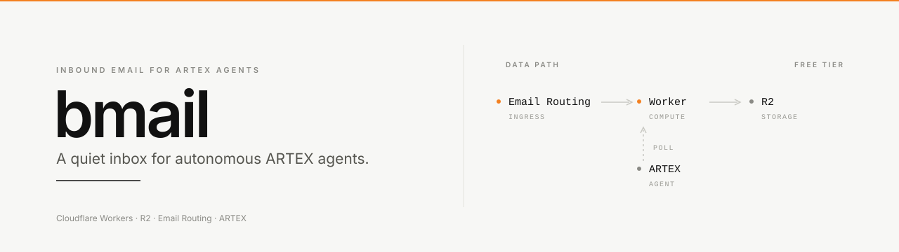

<p align="center">
  
</p>

<p align="center">
  
  
  
  
  <a href="https://github.com/BaaRai/ARTEX"></a>
  
  <br/><a href="https://deploy.workers.cloudflare.com/?url=https://github.com/its0din-ai/bmail"></a>
</p>

# bmail

Bounty Mail (bmail); A tiny inbound email inbox for autonomous agents, built on the Cloudflare Free plan; Giving an agent direct access to our mailboxes is very concerning. With bmail, an email could be routed to Cloudflare Workers and tells the Agent to poll for messages. Useful if testing for Registration Features that requires Email Access; Peoples are always lazy such as handling over the OTP to the Agents.

- **Cloudflare Workers** receive mail and serve the REST API.
- **Cloudflare Email Routing** handles MX, catch-all, and literal address rules.
- **Cloudflare R2** stores the raw message and a per-address latest marker.
- **ARTEX** polls the REST API through the custom tools in [`artex-custom-tools.json`](./artex-custom-tools.json). bmail ships no client and no UI.

bmail is the inbound mailbox for [ARTEX](https://github.com/BaaRai/ARTEX), the self-hosted autonomous penetration testing platform. ARTEX creates the custom tools from `artex-custom-tools.json`; bmail stores the mail those tools read.

No database, no aliases, no bundled integrations. One Worker, one R2 bucket, one shared key.

## Table of contents

- [Cloudflare products used](#cloudflare-products-used)
- [Architecture](#architecture)
- [Flow](#flow)
- [Recipient allowlist](#recipient-allowlist)
- [Forwarding](#forwarding)
- [Requirements](#requirements)
- [Setup](#setup)
- [Deploy with the Cloudflare dashboard](#deploy-with-the-cloudflare-dashboard)
- [Configuration](#configuration)
- [Local development](#local-development)
- [Sanity check](#sanity-check)
- [REST API](#rest-api)
- [ARTEX custom tools](#artex-custom-tools)
- [Ack and lifecycle](#ack-and-lifecycle)
- [Free plan budget](#free-plan-budget)
- [Observability](#observability)
- [Troubleshooting](#troubleshooting)
- [Project layout](#project-layout)
- [Security notes](#security-notes)
- [Limits](#limits)
- [License](#license)

## Cloudflare products used

| Product | Role in bmail | Free plan note |
|---|---|---|
| **Cloudflare Workers** | Runs the `email()` ingest handler and the HTTPS REST API. | 100,000 requests/day, 10 ms CPU per invocation. |
| **Cloudflare Email Routing** | Receives mail at the domain MX, applies catch-all or literal rules, invokes the Worker, and prepends a trusted `Authentication-Results` header. | Free. 25 MiB inbound limit, 200 routing rules per domain. Routing rules decide what reaches the Worker; bmail applies a second allowlist. |
| **Cloudflare R2** | Stores `mail/<address>/<id>.eml` and the `latest/<address>` marker. Serves list, head, get, and delete operations. Holds the lifecycle rule. | 10 GB-month, 1M Class A and 10M Class B operations/month, free egress. |
| **Cloudflare DNS** | Hosts the zone, MX records, and the domain used by Email Routing. | Included with the zone. |
| **Wrangler** | Local dev, deploy, secret upload, and `r2 bucket lifecycle set`. | CLI. |
| **Workers Logs** | Persisted invocation and custom logs, visible in the dashboard. | Free: 200,000 log events/day, 3-day retention. |

**Not used, on purpose:** D1, KV, Durable Objects, Queues, Pages, Access, and Email Sending. The only state lives in R2.

## Architecture

```text
                         Internet mail
                              |
                              v
             Cloudflare Email Routing  (MX, catch-all)
                    |                       |
                    |                       +--> bmail_forward_to --> personal inbox (archive)
                    v
             Cloudflare Worker  email()
                    |
                    v
             Cloudflare R2
             mail/<address>/<id>.eml  +  latest/<address>

   ARTEX -- HTTPS + Bearer --> Cloudflare Worker  fetch()
                                        |
                                        +--> R2 head / list / get / delete
```

## Flow

1. Pick an address that matches the allowlist, for example `test@mail.example.com` or `bbounty@programs.example.net`.
2. Cloudflare Email Routing delivers it to the Worker.
3. The Worker stores the raw MIME in R2 and updates `latest/<address>`.
4. If `bmail_forward_to` is set, the Worker forwards a copy to that destination.
5. ARTEX polls the REST API, or you inject a local email during development.
6. It reads the raw message and parses it in your own code.
7. After a successful read, `DELETE /v1/inbox/:address/:id` removes the R2 copy. Your forwarded archive is unaffected.
8. The R2 lifecycle rule deletes anything that was not acknowledged after `bmail_lifecycle_days`.

There is no registration step. The Worker accepts addresses that match its recipient allowlist.

## Recipient allowlist

`bmail_mail_domains` accepts two forms:

- `mail.example.com` - any local part on that domain.
- `bbounty@programs.example.net` - exactly that address.

There is no wildcard syntax. Use the bare domain when you want every local part. `*@mail.example.com` and `*` are rejected with a `wildcards are not supported` error.

For example:

```bash
bmail_mail_domains=mail.example.com,bbounty@programs.example.net
```

This accepts `test@mail.example.com` and `bbounty@programs.example.net`, but drops `other@programs.example.net`.

Email Routing is the first gate. It decides which mail reaches the Worker:

- A **catch-all** rule sends every local part to the Worker. Pair it with a domain entry.
- A **literal** rule sends one address to the Worker. Pair it with an exact address entry.

A common setup is one catch-all domain plus one fixed program address:

```text
mail.example.com               catch-all -> bmail Worker
bbounty@programs.example.net   literal -> bmail Worker
programs.example.net           catch-all -> personal inbox (archive)
```

The literal rule wins over the catch-all, so only `bbounty@programs.example.net` reaches the Worker on that domain.

## Forwarding

Set `bmail_forward_to` to one address when you also want a normal inbox copy:

```bash
bmail_forward_to=archive@example.net
```

The Worker stores the message in R2 first, then calls `message.forward()`. A forward failure is logged as `bmail: forward failed` and does not reject or delete the R2 copy, so ingestion still succeeds.

Cloudflare requires the destination to be **verified** under **Email Routing** > **Destination addresses**. It also refuses to forward to an address that routes back to the same Worker, which prevents mail loops. Use `none` or an empty value to disable forwarding. `bmail_forward_to` accepts one full email address, not a domain or a comma-separated list.

If you prefer, you can skip `bmail_forward_to` and keep the personal archive on the Email Routing catch-all instead, as shown above. Do not give the same routing rule two actions.

## Requirements

- Cloudflare account on the Free plan.
- A domain on Cloudflare with Email Routing.
- An R2 bucket.
- Node.js 22 or newer, pnpm 10 or newer.

## Setup

```bash
pnpm install
cp .env.example .env
# fill in bmail_mail_domains, bmail_api_key, cloudflare_r2_bucket_name
# optionally set bmail_forward_to to a verified destination
wrangler login
wrangler r2 bucket create <cloudflare_r2_bucket_name>
pnpm deploy:worker
```

`pnpm deploy:worker` deploys the Worker, uploads `bmail_api_key` as a secret, maps `bmail_mail_domains` and `bmail_forward_to` as runtime variables, and sets the R2 lifecycle rules.

### One-click deploy

The **Deploy to Cloudflare** button next to the Workers badge targets the public `its0din-ai/bmail` repository. It provisions the R2 binding from `wrangler.jsonc` and prompts for all three runtime values from `.dev.vars.example`:

- `bmail_api_key` - the bearer token for the REST API.
- `bmail_mail_domains` - the comma-separated allowlist of addresses or domains to catch.
- `bmail_forward_to` - a verified forwarding destination, or `none` to disable forwarding.

Cloudflare stores these as Worker **secrets** at deploy time. Secrets are not deleted by later deploys, so rebuilding the Worker from Git keeps the same environment. The button also sets `keep_vars: true`, which protects any plaintext variables you add in the dashboard.

The repository must be public and pushed for the button to work. After it finishes, configure Email Routing and add the R2 lifecycle rules manually, because the one-click flow does not run `pnpm deploy:worker`.

If the button fails or you use a fork, point the `url` parameter at your public repository root.

Then in the Cloudflare dashboard:

1. Enable Email Routing on each domain used in `bmail_mail_domains`.
2. For a catch-all domain, set the catch-all action to the `bmail` Worker.
3. For a single address, create one literal routing rule to the `bmail` Worker.
4. If you want a personal archive, either set `bmail_forward_to` to a verified destination (it must not route back to this Worker), or use a literal rule for the agent address and leave the catch-all forwarding to your inbox. Do not give the same rule two actions.

## Deploy with the Cloudflare dashboard

Use this path if you want to create and configure the Worker in the Cloudflare web UI. The in-browser editor path uses the bundled `dist/index.js`, which you build locally with `pnpm build`. The Git-based flow builds from source in Cloudflare.

The in-browser editor does not read `wrangler.jsonc` and does not run `scripts/deploy.mjs`, so bindings, variables, and the R2 lifecycle rules are set by hand. The Git flow uses `wrangler.jsonc` for the Worker name, entry point, and R2 binding; variables and lifecycle rules are still manual.

| Path | Config source | Lifecycle rule |
|---|---|---|
| CLI (`pnpm deploy:worker`) | `.env` and `wrangler.jsonc` | Applied by the script. |
| Dashboard editor | UI bindings and variables | Added manually in R2 settings. |
| Dashboard Git | `wrangler.jsonc` plus UI variables | Added manually in R2 settings. |

### 1. Create the R2 bucket

1. Cloudflare dashboard > **R2 object storage** > **Create bucket**.
2. Name it, for example `bmail-mail`, and create it.

### 2. Create the Worker

1. **Workers & Pages** > **Create application**.
2. Choose the in-browser Worker or Hello World option if your account shows it.
3. Name it `bmail` and deploy.
4. Open the Worker and select **Edit code** (some accounts label this **Quick Edit**).

If your account only shows the Git-based **Create application** flow, use that instead:

1. Push this repository to GitHub or GitLab.
2. Connect it in **Workers & Pages** > **Create application**.
3. Root directory: the repository root.
4. Build command: `pnpm install`.
5. Deploy command: `npx wrangler deploy`.
6. Create the R2 bucket with the name in `wrangler.jsonc` (`bmail-mail`), or edit that file before pushing.
7. Add `bmail_mail_domains` and `bmail_api_key` in the dashboard as described in step 4 below.

### 3. Paste the Worker code

Skip this step if you used the Git-based flow; it deploys from source.

The dashboard editor is safest with JavaScript, so use the bundled Worker instead of the TypeScript source.

```bash
pnpm install
pnpm build
```

1. Open `dist/index.js`.
2. Replace the editor contents with that file.
3. Remove the final `//# sourceMappingURL=index.js.map` line if it is present.
4. Select **Deploy**.

If your editor accepts TypeScript, `src/index.ts` also works.

### 4. Add the binding and variables

In the Worker settings:

- **Bindings** > **Add binding** > **R2 bucket**:
  - Variable name: `MAIL`
  - Bucket: the bucket you created
  - Skip this if you used the Git flow; `wrangler.jsonc` already declares the binding.
- **Variables and Secrets**:
  - `bmail_mail_domains` as text: a comma-separated allowlist. A domain accepts any local part; a full address is exact. For example `mail.example.com,bbounty@programs.example.net`
  - `bmail_api_key` as a secret: at least 16 random characters
  - `bmail_forward_to` as text (optional): one verified destination address, or `none`

Plaintext variables survive redeploys because `wrangler.jsonc` sets `keep_vars: true`. Secrets are never deleted by a deploy. If you use the one-click button, all three values are already stored as secrets.

Do not add `cloudflare_r2_bucket_name` as a Worker variable. It is only read by `pnpm deploy:worker`; the dashboard path uses the R2 binding instead.

Save and deploy. The API returns `503` until the binding and key exist.

### 5. Set the compatibility date

Go to **Settings** > **Runtime** > **Compatibility date** and use `2026-03-12` or a later date supported by your account. No compatibility flags are required.

### 6. Add the R2 lifecycle rules

Go to **R2 object storage** > your bucket > **Settings** > **Object lifecycle rules**:

- Rule `bmail-expire-mail`, prefix `mail/`, delete after 7 days.
- Rule `bmail-expire-latest`, prefix `latest/`, delete after 7 days.

Use a longer window if you want more recovery time. New rules can take up to 24 hours to apply. The Worker does not need `bmail_lifecycle_days` in the dashboard path; that variable is only used by `pnpm deploy:worker`.

### 7. Route mail to the Worker

Go to **Compute** > **Email Service** > **Email Routing**, or the zone's **Email** > **Email Routing** page:

1. Enable Email Routing for the domain. For a subdomain, add it under **Settings** > **Subdomains** first.
2. For a catch-all domain: **Routing rules** > **Catch-all** > action **Send to Worker** > `bmail`.
3. For one address: **Create routing rule**, enter the local part, action **Send to Worker** > `bmail`.
4. If you need a personal archive, either set `bmail_forward_to` and verify that destination under **Destination addresses**, or use a literal rule for the agent address to the Worker and leave the catch-all forwarding to your inbox. Do not route the forwarding destination back to this Worker.

### 8. Verify

```bash
curl https://<worker-url>/health
```

Then send a message to `test@mail.example.com` and list it:

```bash
curl 'https://<worker-url>/v1/inbox/test%40mail.example.com' \
  -H "authorization: Bearer <bmail_api_key>"
```

The following values are only used by the CLI deploy script, so you can leave them out of the dashboard path: `bmail_lifecycle_days`, `cloudflare_worker_name`, `cloudflare_r2_bucket_name`, `cloudflare_account_id`.

## Configuration

### Runtime variables and secrets

- `bmail_mail_domains`, `bmail_api_key`, and `bmail_forward_to` are runtime values. Set them in **Settings** > **Variables and Secrets**.
- The Deploy to Cloudflare button prompts for all three from `.dev.vars.example` and stores them as **secrets**. Secrets are not deleted by a deploy, so a rebuild keeps the same environment.
- `wrangler.jsonc` sets `keep_vars: true`. That protects plaintext variables you add in the dashboard from a rebuild or redeploy.
- **Build** variables and secrets are available only during the build. The Worker cannot read them with `env.*`.
- Do not commit real values or add secrets to `vars` in `wrangler.jsonc`.

`.env` is the source of truth for local and CLI use. `pnpm dev` writes `.dev.vars`; `pnpm deploy:worker` maps the values to Worker vars and secrets.

| Key | Used by | Purpose |
|---|---|---|
| `bmail_mail_domains` | Worker | Comma-separated allowlist. Domain entries accept any local part; full-address entries are exact. |
| `bmail_api_key` | Worker and smoke test | Shared bearer key, 16+ characters. |
| `bmail_forward_to` | Worker | Optional verified destination for forwarding every caught message. `none` or empty disables it. |
| `bmail_lifecycle_days` | CLI deploy | R2 expiry for `mail/` and `latest/`, default 7. The dashboard path sets these rules in the UI. |
| `cloudflare_worker_name` | Deploy | Worker name. |
| `cloudflare_r2_bucket_name` | Deploy | R2 bucket name. |
| `cloudflare_account_id` | Deploy | Optional account id. |
| `bmail_api_url` | Smoke test | Worker base URL. |
| `bmail_address` | Smoke test | Optional default address. |
| `bmail_local_email_url` | Smoke test | Optional local email injection base. Defaults to `bmail_api_url` when it is localhost. |

## Local development

```bash
pnpm dev
```

`pnpm dev` writes `.dev.vars` from `.env` and listens on `127.0.0.1:8787`.

Send a local message:

```bash
curl --request POST 'http://127.0.0.1:8787/cdn-cgi/handler/email?from=sender@example.com&to=test@mail.example.com' \
  --data-raw 'From: sender@example.com
To: test@mail.example.com
Subject: Test
Content-Type: text/plain

Your code is 123456.'
```

Read it:

```bash
curl 'http://127.0.0.1:8787/v1/inbox/test%40mail.example.com' \
  -H "authorization: Bearer $bmail_api_key"
```

## Sanity check

### Local, automatic

```bash
# terminal 1
pnpm dev

# terminal 2
bmail_api_url=http://127.0.0.1:8787 \
bmail_api_key=<your key> \
bmail_address=test@mail.example.com \
pnpm smoke
```

On a local API the script injects a test email through `/cdn-cgi/handler/email`, then checks:

- `/health`
- wrong key returns 401
- unlisted address returns 403
- message appears in the list
- raw MIME contains the marker
- ack returns 204
- raw after ack returns 404
- the message disappears from the list

### Deployed, automatic

```bash
bmail_api_url=https://<worker-url> \
bmail_api_key=<your key> \
bmail_address=test@mail.example.com \
pnpm smoke
```

The script prints a unique subject and waits up to 90 seconds. Send a real email from any mailbox to that address with that exact subject. It then runs the same list, raw, and ack checks.

A deployed Worker cannot inject mail into Email Routing, so the real email is required.

### Manual checklist

1. `GET /health` returns `{ "ok": true, "ready": true }` and all four checks pass.
2. Send a message with a unique subject.
3. `GET /v1/inbox/<address>` returns metadata; copy the `id`.
4. `GET /v1/inbox/<address>/<id>` returns the raw MIME with your marker.
5. `DELETE /v1/inbox/<address>/<id>` returns `204`.
6. The raw route now returns `404`, and the list no longer contains that id.
7. R2 > your bucket > Objects: the object count drops after ack.
8. Compute > Email Service > Email Routing > Activity log: the message shows `Handled` plus SPF, DKIM, and DMARC results.
9. Wrong key returns `401`. An address outside the allowlist returns `403`.
10. If you use an exact address entry, send to a different local part on that domain. It should be dropped and never appear in the list.

Example curl checks:

```bash
curl https://<worker-url>/health

curl 'https://<worker-url>/v1/inbox/test%40mail.example.com' \
  -H "authorization: Bearer $bmail_api_key"

curl 'https://<worker-url>/v1/inbox/test%40mail.example.com/<id>' \
  -H "authorization: Bearer $bmail_api_key"

curl -X DELETE 'https://<worker-url>/v1/inbox/test%40mail.example.com/<id>' \
  -H "authorization: Bearer $bmail_api_key"
```

## REST API

All `/v1` routes require `Authorization: Bearer <bmail_api_key>`.

| Route | Purpose |
|---|---|
| `GET /health` | Liveness and readiness checks. |
| `GET /v1/inbox/:address?after=<cursor>&limit=<n>` | List message metadata, paged with `next_cursor`. |
| `GET /v1/inbox/:address/:id` | Raw RFC 5322 message. |
| `DELETE /v1/inbox/:address/:id` | Acknowledge and delete the stored copy. |

The address must be URL encoded. `after` is the `next_cursor` from the previous response. `limit` is 1 to 200, default 50. Delete is idempotent and returns `204`.

Parsing is your tool's job. The Worker stores and returns bytes; it does not parse MIME.

## ARTEX custom tools

The repository includes [`artex-custom-tools.json`](./artex-custom-tools.json), three HTTP custom tool definitions for [ARTEX](https://github.com/BaaRai/ARTEX):

- `bmail_list_messages`
- `bmail_get_message`
- `bmail_ack_message`

To install them:

1. Open `artex-custom-tools.json` and replace `YOUR_WORKER_URL` with the full `https://` Worker URL, and `YOUR_BMAIL_API_KEY` with the shared key.
2. Feed the whole file into the ARTEX chat.
3. Ask the ARTEX auto agent:

   > Create these custom tools with `create_custom_tool`, bind them to my agent, and enable them.

The `auto` agent has the `create_custom_tool` platform tool by default. If you use another agent, change `agents` in every tool entry before feeding the file.

After creation, verify with a prompt such as:

> Use bmail_list_messages for test@mail.example.com.

Notes:

- ARTEX HTTP tools make a single request. For waiting, call `bmail_list_messages` again with the previous `next_cursor` as `after`.
- `bmail_get_message` returns raw MIME. Parse it in ARTEX or with another tool.
- `bmail_ack_message` deletes the R2 copy. It is destructive; call it only after a successful read.
- The API key is stored in the tool's Authorization header. ARTEX masks header values in its tool UI. If you do not want the key in the chat transcript, create the tools with a placeholder and set the header in the ARTEX UI afterward.

## Ack and lifecycle

- `DELETE /v1/inbox/:address/:id` removes `mail/<address>/<id>.eml` immediately.
- The `latest/<address>` marker may still point at the deleted object. New mail updates it, so this is harmless.
- `pnpm deploy:worker` sets two R2 lifecycle rules, `mail/` and `latest/`, each expiring after `bmail_lifecycle_days` (default 7).
- The lifecycle command replaces the bucket's lifecycle configuration, so use a dedicated bucket or merge your own rules into the generated file.

## Free plan budget

| Operation | R2 class | When |
|---|---|---|
| Store a message | Class A | 2 per received email: the `.eml` plus the latest marker. |
| Read a message | Class B | 1 per raw read. |
| Poll with a cursor and no new mail | Class B | 1 `head` per poll. |
| Poll that finds new mail | Class B + A | 1 `head` plus 1 `list`. |
| List without a cursor | Class A | First call only. |
| Acknowledge a message | Free | 1 `DeleteObject` per ack. |

A cursor poll does not call `ListObjects` unless the latest marker says something newer exists. That keeps polling cheap.

R2 Free includes 1M Class A operations, 10M Class B operations, and 10 GB-month of storage. Workers Free includes 100,000 requests/day. Your polling interval determines the request count; the Worker does not impose one.

## Observability

`wrangler.jsonc` enables Workers Logs at 100% sampling:

```jsonc
"observability": {
  "enabled": true,
  "head_sampling_rate": 1,
  "logs": {
    "enabled": true,
    "invocation_logs": true,
    "persist": true
  }
}
```

- View persisted logs in **Workers & Pages** > `bmail` > **Observability**.
- Workers Free includes 200,000 log events per day with 3-day retention.
- The Worker emits custom logs for `bmail: received`, `bmail: stored`, config problems, and R2 write failures. It does not log message bodies or the API key.
- `wrangler tail bmail` still works for real-time logs and does not depend on the persistence setting.
- The in-browser editor path does not read `wrangler.jsonc`. If you use that path, enable **Observability** in the Worker settings.

## Troubleshooting

### `ready: false` on `/health`

`GET /health` reports the runtime prerequisites:

```json
{
  "ok": true,
  "ready": false,
  "version": "0.2.0",
  "checks": {
    "bmail_mail_domains": { "present": true, "valid": true },
    "bmail_api_key": { "present": false, "valid": false },
    "bmail_forward_to": { "present": true, "valid": true },
    "r2_binding": false
  }
}
```

- `present: false` - the variable or secret is not on the running Worker version. Check the environment (Production vs Preview), make sure it is a runtime variable and not a build variable, and deploy a new version.
- `present: true` and `valid: false` - the value exists but is unusable. For `bmail_mail_domains`, check quotes, wildcards, or an empty entry. For `bmail_api_key`, the value must be at least 16 characters. For `bmail_forward_to`, use one full address or `none`.
- `r2_binding: false` - add an **R2 bucket binding** with variable name `MAIL`. A plain text variable named `MAIL` does not count; the check requires the R2 API. An environment variable named `cloudflare_r2_bucket_name` is not a binding and the Worker does not read it.

Make the change, deploy a new version, and call `/health` again. The Worker also logs a `bmail: not ready {...}` line with the same presence and validity flags, visible in `wrangler tail`.

### Delivery failed: `worker script threw an exception`

The Email Routing activity log only reports a generic upstream error. The Worker log has the actual exception.

1. Start live logs:
   ```bash
   wrangler tail bmail
   ```
   Or open the Worker in the dashboard and use **Logs** > **Real-time logs**.
2. Send another test email.
3. Look for:
   - `bmail: received <address> size=<n>` - the handler started.
   - `bmail: stored <address> id=<id>` - the R2 writes succeeded.
   - `bmail: forwarded <address> to <destination>` - the optional forward succeeded.
   - `bmail: forward failed` - the message was stored, but forwarding failed. Verify the destination under Email Routing > Destination addresses and make sure it does not route back to this Worker. This does not reject the message.
   - `bmail: MAIL is not an R2 binding` - delete any plain variable named `MAIL` and add an R2 bucket binding named `MAIL`.
   - `bmail: R2 message write failed` - the binding exists but the write failed; check the bucket still exists, the binding points to the right bucket, and R2 usage is within quota.
   - `Provided readable stream must have a known length` - the deployed Worker is older than the `FixedLengthStream` fix. Production R2 rejects unknown-length streams, while local R2 is more permissive. Redeploy the current `src/index.ts`.

If there is no `bmail: received` line, the running Worker does not have the email handler or your recipient allowlist rejected the message before storage.

Also re-check `/health`. `r2_binding` should still be true after the deployment that added your variables. A redeploy from `wrangler.jsonc` can replace a dashboard binding if the bucket name in the file is different.

### `config_invalid`

```json
{
  "error": {
    "code": "config_invalid",
    "message": "bmail_mail_domains is missing or invalid"
  }
}
```

The Worker parses `bmail_mail_domains` before it checks the API key, so this error is not about the key.

Check:

1. The variable exists on the Worker that serves this URL, in the environment you are calling (production vs preview).
2. The name is exactly `bmail_mail_domains`.
3. The value is a comma-separated list with no surrounding quotes, for example `mail.example.com,bbounty@programs.example.net`. Do not use `*@mail.example.com` or `*`; use the bare domain instead.
4. Dashboard and Git deploys do not read `.env`. Add the variable under **Settings** > **Variables and Secrets**.
5. Deploy a new version after changing it.
6. Run `wrangler tail <worker-name>` and call the endpoint again. The Worker log shows the exact parse error, for example an empty value or an invalid domain.

A CLI deploy also passes `bmail_mail_domains` from `.env` with `--var`, so make sure `.env` has the value you want for that deployment.

### `unauthorized`

```json
{
  "error": {
    "code": "unauthorized",
    "message": "Missing or invalid API key"
  }
}
```

Check `Authorization: Bearer <bmail_api_key>`. The key must match the Worker secret exactly and be at least 16 characters.

## Project layout

```text
src/                    Worker source: email() ingest and REST API
test/                   Worker tests
scripts/                dev, deploy, and smoke helpers
assets/                 README banner
artex-custom-tools.json ARTEX HTTP custom tool definitions
wrangler.jsonc          Worker configuration
```

## Security notes

- One shared key grants access to every configured address. Rotate it by changing `bmail_api_key`.
- Keys are compared in constant time and the key is never logged.
- Addresses are validated before being used in an R2 key, so a local part cannot escape its prefix.
- Only the first `Authentication-Results` header with `mx.cloudflare.net` as authserv-id is trusted for DMARC.
- R2 is private. Only the Worker binding reads it.
- MIME parsing happens in your tool, not in the Worker.
- When `bmail_forward_to` is set, the forwarded copy is an archive; ack only removes the R2 copy. The destination must be verified in Email Routing and must not route back to this Worker.
- There is no rate limiting. The Workers daily request cap is the backstop.

## Limits

- Inbound message size is capped by Cloudflare at 25 MiB.
- `limit` is capped at 200 per list call.
- There is no bundled client or UI.
- There is no alias manager, arbitrary outbound mail, or D1. The only outbound message is the optional forward.

## License

Not set yet.
